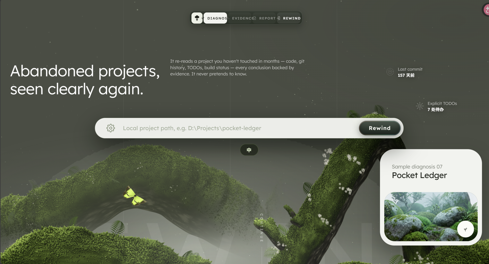
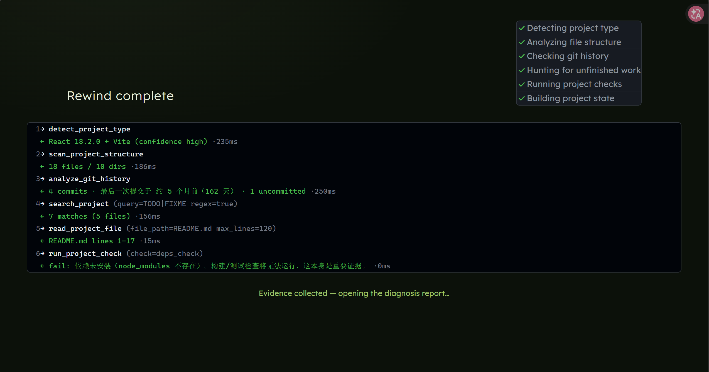
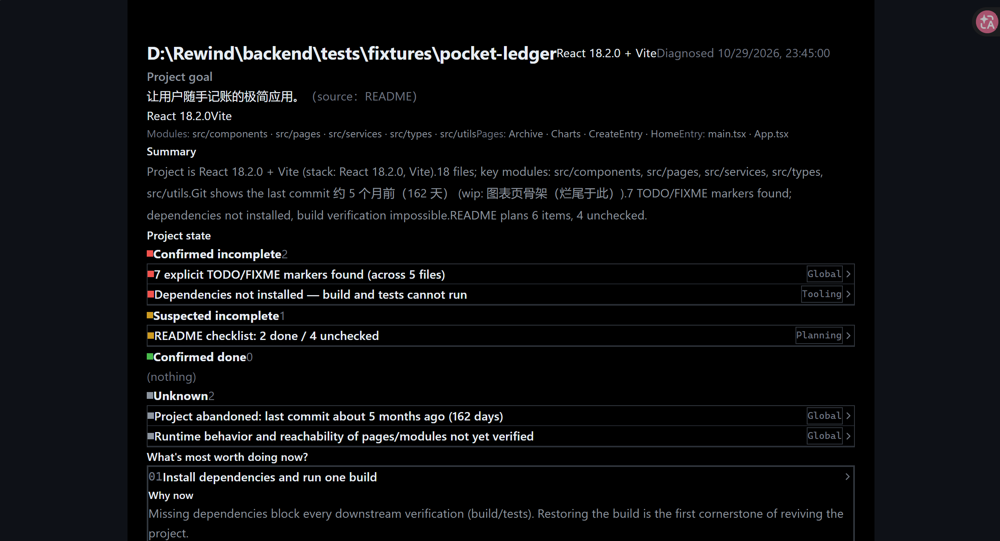

# Rewind

Drop an abandoned project folder into it, and it tells you what state the project is actually in.

Everyone has half-built projects that haven't been touched in months. When you finally reopen one, you've forgotten what you were trying to make, how far you got, or why you stopped. Rewind doesn't ask you to re-explain the project — it investigates on its own: reading code, digging through git history, hunting for TODOs, running build checks. Then it answers four questions with evidence: what's done, where it stalled, why it stalled, and what's worth doing next.

It runs on one hard rule: **never pretend to know.** Every conclusion comes with its evidence (file, line number, git commit), and anything it can't verify is explicitly marked "unknown."

[中文文档](README.zh-CN.md)



## Quick Start

You only need Python 3.10+ (the frontend ships pre-built; Node is only required if you want to modify it).

```bash
git clone https://github.com/shuyi33/rewind.git
cd rewind/backend
pip install -r requirements.txt
python -m uvicorn main:app --port 8000
```

Open http://127.0.0.1:8000. Click the gear on the left of the search bar to open Settings, pick a provider (OpenRouter / DeepSeek / Zhipu GLM / OpenAI / local Ollama), paste your API key, and save — it takes effect immediately, no restart. No key? Flip on Mock mode: the full pipeline still runs with real tool execution; only the final report is heuristic-generated, which is enough to feel the whole flow.

Rewind runs locally and analyzes projects on your machine. Your code never passes through any intermediate server (except the evidence sent to the LLM provider you configure). Your key stays in a local `backend/.env` and never enters git.

## How It Works

Unlike "dump the whole project into a prompt," Rewind runs a real tool-calling agent loop:

The model decides what it needs to know, calls a tool, the tool actually executes on your disk, results are fed back, and the model decides what to do next — until the evidence is sufficient to emit a structured diagnosis report, strictly validated by pydantic (invalid output gets bounced back for a retry). The whole process streams to the frontend over SSE, so you watch the agent investigate in real time.

Six tools:

- `scan_project_structure` — directory tree and key files
- `detect_project_type` — tech stack detection, with evidence
- `analyze_git_history` — commits and time-since-abandonment
- `search_project` — TODO / FIXME / reference search
- `read_project_file` — file reading with path-escape protection
- `run_project_check` — build / test / dependency checks (command whitelist)

Security is designed in, not bolted on: file access must resolve inside the project root; the model can only pick from fixed check types, with actual commands generated from a whitelist, force-timed and output-truncated. Diagnosis never modifies a single file in your project.

If the step budget runs out before a report is ready, it falls back to a heuristic report built from whatever evidence was collected — clearly labeled, never fabricated. Reports persist to local SQLite and can be revisited or annotated with the project goal later.





## Tests

```bash
cd backend
python tests/init_fixture_git.py       # seed the built-in fixture's git history (idempotent)
python tests/test_phase2_scan.py       # project scanning
python tests/test_phase3_tools.py      # six tools + security boundaries
python tests/test_phase4_agent_loop.py # agent loop end-to-end
```

`tests/fixtures/pocket-ledger/` is a built-in "abandoned sample project" (a budgeting app that planned six features, finished two, and stalled five months ago) used for end-to-end verification.

## UI

The hero visual is built on Meng To's [ThreeUI](https://threeui.com) (Sylva scene, MIT licensed), with the Living Green design language carried through the home, scanning and report pages.

## License

MIT
